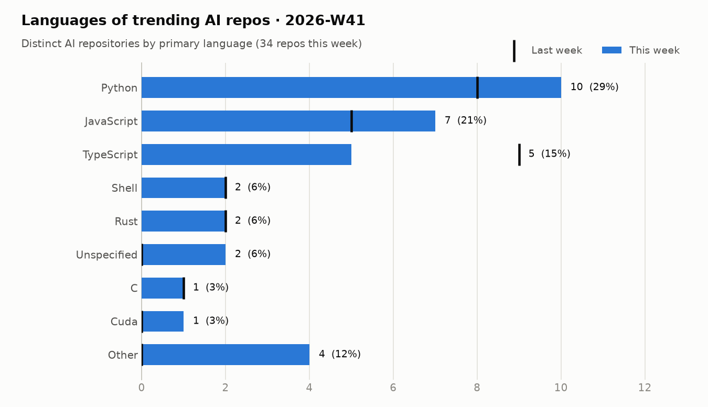
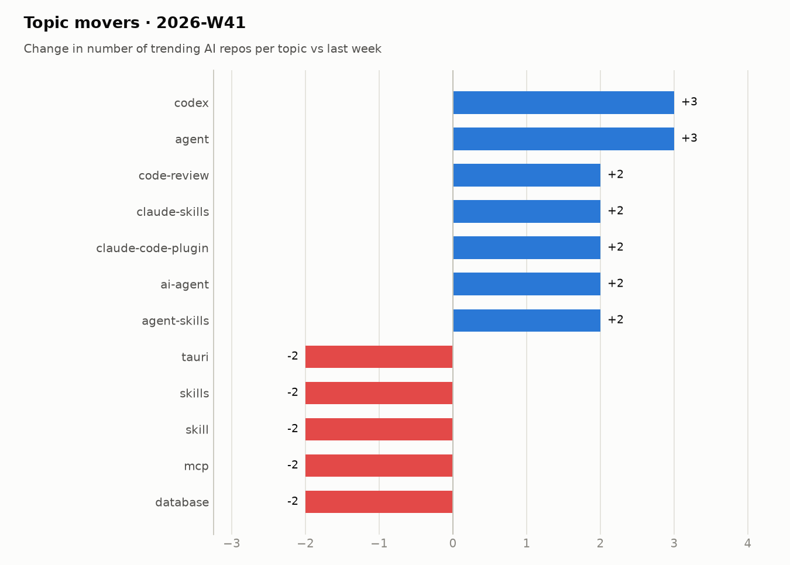

# Trending AI repos · 2026-W41

05 Oct 2026 – 11 Oct 2026

## Summary

- **34** distinct AI repos trended over 7 day(s) (last week: 29)
- AI share of all trending slots: **75%** (-3 pts vs last week)
- Dominant language: **Python** (29% of AI repos)
- Rising topics: `agent` (+3), `codex` (+3), `agent-skills` (+2), `ai-agent` (+2), `claude-code-plugin` (+2)
- New this week: `agent`, `openai`, `code-review`, `macos`, `neural-network`

## Languages

<picture><source media="(prefers-color-scheme: dark)" srcset="../../charts/2026-W41-languages-dark.png"></picture>

| Language | Repos | Share | Last week |
|---|--:|--:|--:|
| Python | 10 | 29% | 8 |
| JavaScript | 7 | 21% | 5 |
| TypeScript | 5 | 15% | 9 |
| Shell | 2 | 6% | 2 |
| Rust | 2 | 6% | 2 |
| Unspecified | 2 | 6% | 0 |
| C | 1 | 3% | 1 |
| Cuda | 1 | 3% | 0 |
| HTML | 1 | 3% | 0 |
| Swift | 1 | 3% | 0 |

## Topics

<picture><source media="(prefers-color-scheme: dark)" srcset="../../charts/2026-W41-topics-dark.png"></picture>

| Topic | Repos this week |
|---|--:|
| `claude-code` | 9 |
| `codex` | 7 |
| `claude` | 6 |
| `agent-skills` | 6 |
| `claude-code-plugin` | 4 |
| `ai-agents` | 4 |
| `developer-tools` | 4 |
| `mcp` | 4 |
| `cli` | 3 |
| `cursor` | 3 |
| `ai-agent` | 3 |
| `agent` | 3 |

## Most persistent AI repos

| Repo | Language | Days trending | Stars gained | Total stars |
|---|---|--:|--:|--:|
| [morluto/rea](https://github.com/morluto/rea) | TypeScript | 5 | 56,069 | 81,717 |
| [mattpocock/skills](https://github.com/mattpocock/skills) | Shell | 5 | 7,489 | 285,047 |
| [cathrynlavery/diagram-design](https://github.com/cathrynlavery/diagram-design) | HTML | 5 | 5,142 | 49,348 |
| [thedotmack/claude-mem](https://github.com/thedotmack/claude-mem) | TypeScript | 5 | 2,944 | 98,772 |
| [storytold/artcraft](https://github.com/storytold/artcraft) | Rust | 3 | 9,077 | 15,396 |
| [DuarteSantos8/openGym](https://github.com/DuarteSantos8/openGym) | JavaScript | 3 | 4,345 | 7,507 |
| [anthropics/knowledge-work-plugins](https://github.com/anthropics/knowledge-work-plugins) | Python | 3 | 1,726 | 28,952 |
| [addyosmani/agent-skills](https://github.com/addyosmani/agent-skills) | JavaScript | 3 | 1,449 | 104,218 |
| [earthtojake/text-to-cad](https://github.com/earthtojake/text-to-cad) | Python | 3 | 1,139 | 18,162 |
| [Panniantong/Agent-Reach](https://github.com/Panniantong/Agent-Reach) | Python | 2 | 2,135 | 92,214 |
