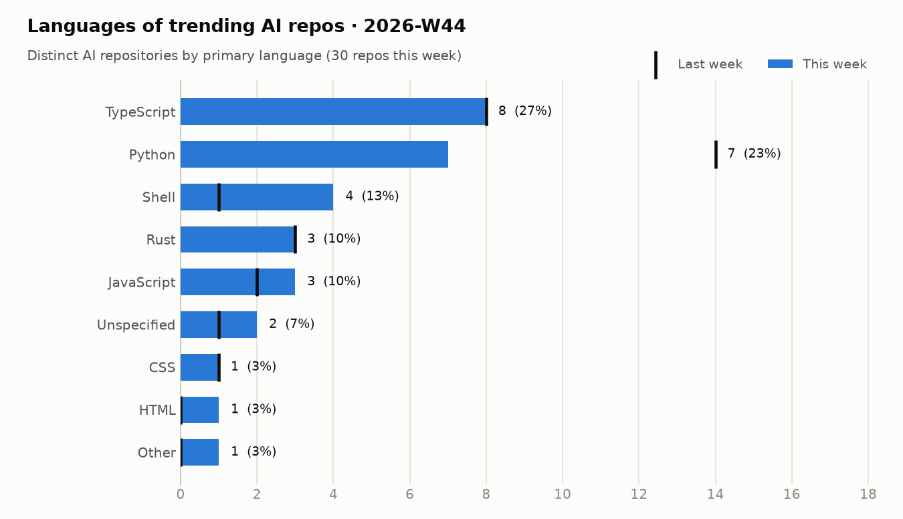
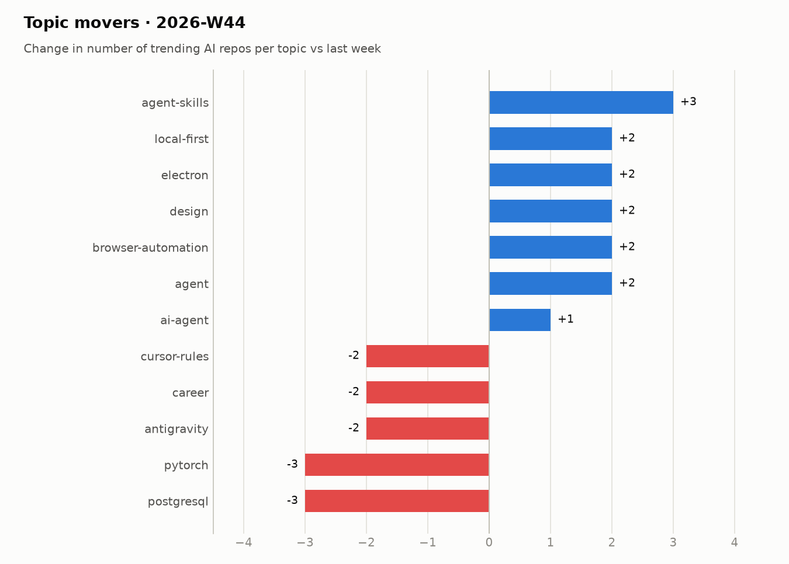

# Trending AI repos · 2026-W44

26 Oct 2026 – 01 Nov 2026

## Summary

- **30** distinct AI repos trended over 7 day(s) (last week: 31)
- AI share of all trending slots: **82%** (+3 pts vs last week)
- Dominant language: **TypeScript** (27% of AI repos)
- Rising topics: `agent-skills` (+3), `agent` (+2), `browser-automation` (+2), `design` (+2), `electron` (+2)
- New this week: `design`, `browser-automation`

## Languages

<picture><source media="(prefers-color-scheme: dark)" srcset="../../charts/2026-W44-languages-dark.png"></picture>

| Language | Repos | Share | Last week |
|---|--:|--:|--:|
| TypeScript | 8 | 27% | 8 |
| Python | 7 | 23% | 14 |
| Shell | 4 | 13% | 1 |
| Rust | 3 | 10% | 3 |
| JavaScript | 3 | 10% | 2 |
| Unspecified | 2 | 7% | 1 |
| CSS | 1 | 3% | 1 |
| HTML | 1 | 3% | 0 |
| Zig | 1 | 3% | 0 |

## Topics

<picture><source media="(prefers-color-scheme: dark)" srcset="../../charts/2026-W44-topics-dark.png"></picture>

| Topic | Repos this week |
|---|--:|
| `claude-code` | 9 |
| `ai-agents` | 8 |
| `agent-skills` | 5 |
| `mcp` | 5 |
| `agent` | 4 |
| `codex` | 4 |
| `claude` | 4 |
| `electron` | 3 |
| `local-first` | 3 |
| `anthropic` | 3 |
| `ai-agent` | 2 |
| `ai-assistant` | 2 |

## Most persistent AI repos

| Repo | Language | Days trending | Stars gained | Total stars |
|---|---|--:|--:|--:|
| [pbakaus/impeccable](https://github.com/pbakaus/impeccable) | Rust | 7 | 12,027 | 98,668 |
| [JetBrains/thinkrail](https://github.com/JetBrains/thinkrail) | TypeScript | 6 | 5,335 | 6,693 |
| [HKUDS/DeepTutor](https://github.com/HKUDS/DeepTutor) | Python | 5 | 9,215 | 53,193 |
| [obra/superpowers](https://github.com/obra/superpowers) | Shell | 5 | 4,670 | 310,267 |
| [Nutlope/hallmark](https://github.com/Nutlope/hallmark) | CSS | 4 | 8,501 | 41,191 |
| [makecindy/cindy](https://github.com/makecindy/cindy) | TypeScript | 4 | 4,164 | 8,361 |
| [nightly-labs/openbot](https://github.com/nightly-labs/openbot) | TypeScript | 4 | 2,716 | 4,079 |
| [elayadesign/ai-design-skills](https://github.com/elayadesign/ai-design-skills) | – | 3 | 4,721 | 12,559 |
| [milind-soni/OpenMausBot](https://github.com/milind-soni/OpenMausBot) | TypeScript | 3 | 3,397 | 9,987 |
| [thedotmack/claude-mem](https://github.com/thedotmack/claude-mem) | TypeScript | 3 | 3,199 | 108,287 |
