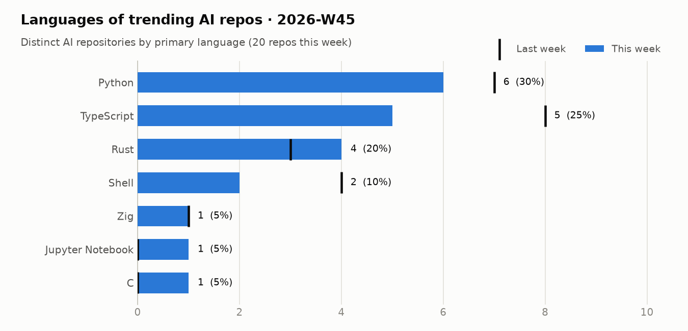
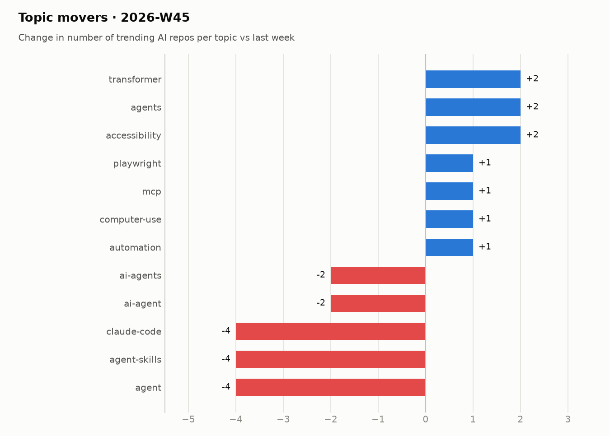

# Trending AI repos · 2026-W45

02 Nov 2026 – 08 Nov 2026

## Summary

- **58** distinct AI repos trended over 7 day(s) (last week: 30)
- AI share of all trending slots: **73%** (-9 pts vs last week)
- Dominant language: **Python** (36% of AI repos)
- Rising topics: `mcp` (+12), `ai-agents` (+11), `automation` (+7), `model-context-protocol` (+6), `mcp-server` (+5)
- New this week: `model-context-protocol`, `mcp-server`, `agents`, `transformer`, `generative-ai`, `accessibility`

## Languages

<picture><source media="(prefers-color-scheme: dark)" srcset="../../charts/2026-W45-languages-dark.png"></picture>

| Language | Repos | Share | Last week |
|---|--:|--:|--:|
| Python | 21 | 36% | 7 |
| TypeScript | 12 | 21% | 8 |
| JavaScript | 7 | 12% | 3 |
| Rust | 6 | 10% | 3 |
| Unspecified | 3 | 5% | 2 |
| Shell | 2 | 3% | 4 |
| C | 2 | 3% | 0 |
| HTML | 2 | 3% | 1 |
| Zig | 1 | 2% | 1 |
| Jupyter Notebook | 1 | 2% | 0 |

## Topics

<picture><source media="(prefers-color-scheme: dark)" srcset="../../charts/2026-W45-topics-dark.png"></picture>

| Topic | Repos this week |
|---|--:|
| `ai-agents` | 19 |
| `mcp` | 17 |
| `claude-code` | 11 |
| `codex` | 8 |
| `automation` | 8 |
| `rag` | 6 |
| `claude` | 6 |
| `model-context-protocol` | 6 |
| `agent-skills` | 6 |
| `mcp-server` | 5 |
| `self-hosted` | 4 |
| `ai-tools` | 4 |

## Most persistent AI repos

| Repo | Language | Days trending | Stars gained | Total stars |
|---|---|--:|--:|--:|
| [mattpocock/skills](https://github.com/mattpocock/skills) | Shell | 5 | 7,542 | 317,022 |
| [vercel-labs/agent-desktop](https://github.com/vercel-labs/agent-desktop) | Rust | 4 | 10,709 | 17,503 |
| [D4Vinci/Scrapling](https://github.com/D4Vinci/Scrapling) | Python | 4 | 6,024 | 98,457 |
| [thedotmack/claude-mem](https://github.com/thedotmack/claude-mem) | TypeScript | 4 | 5,640 | 113,191 |
| [max-sixty/worktrunk](https://github.com/max-sixty/worktrunk) | Rust | 4 | 1,592 | 11,684 |
| [NVIDIA/auto-ontology](https://github.com/NVIDIA/auto-ontology) | Python | 3 | 6,744 | 9,453 |
| [Donchitos/Claude-Code-Game-Studios](https://github.com/Donchitos/Claude-Code-Game-Studios) | Shell | 3 | 3,528 | 35,031 |
| [anomalyco/hex](https://github.com/anomalyco/hex) | Rust | 2 | 1,589 | 4,809 |
| [p-e-w/heretic](https://github.com/p-e-w/heretic) | Python | 2 | 1,121 | 39,063 |
| [garrytan/gstack](https://github.com/garrytan/gstack) | TypeScript | 2 | 902 | 140,235 |
