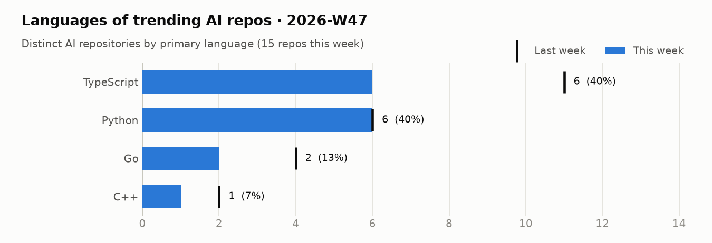
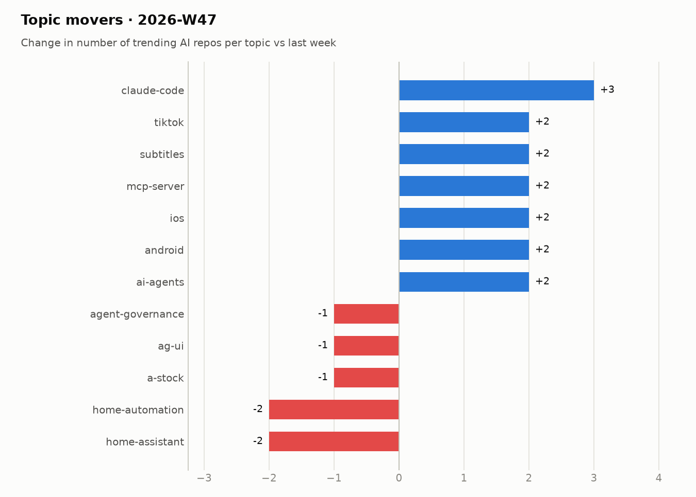

# Trending AI repos · 2026-W47

16 Nov 2026 – 22 Nov 2026

## Summary

- **28** distinct AI repos trended over 7 day(s) (last week: 28)
- AI share of all trending slots: **76%** (+7 pts vs last week)
- Dominant language: **Python** (36% of AI repos)
- Rising topics: `claude-code` (+3), `ai-agents` (+2), `android` (+2), `ios` (+2), `mcp-server` (+2)
- New this week: `tiktok`, `web-search`, `subtitles`, `ios`, `android`

## Languages

<picture><source media="(prefers-color-scheme: dark)" srcset="../../charts/2026-W47-languages-dark.png"></picture>

| Language | Repos | Share | Last week |
|---|--:|--:|--:|
| Python | 10 | 36% | 6 |
| TypeScript | 9 | 32% | 11 |
| Go | 2 | 7% | 4 |
| C++ | 2 | 7% | 2 |
| Shell | 2 | 7% | 1 |
| JavaScript | 1 | 4% | 1 |
| Unspecified | 1 | 4% | 0 |
| HTML | 1 | 4% | 0 |

## Topics

<picture><source media="(prefers-color-scheme: dark)" srcset="../../charts/2026-W47-topics-dark.png"></picture>

| Topic | Repos this week |
|---|--:|
| `claude-code` | 9 |
| `mcp` | 7 |
| `ai-agents` | 6 |
| `codex` | 5 |
| `agent-skills` | 4 |
| `skills` | 3 |
| `code-review` | 3 |
| `mcp-server` | 3 |
| `self-hosted` | 3 |
| `claude` | 3 |
| `agentic-workflow` | 2 |
| `harness` | 2 |

## Most persistent AI repos

| Repo | Language | Days trending | Stars gained | Total stars |
|---|---|--:|--:|--:|
| [google-labs-code/stitch-skills](https://github.com/google-labs-code/stitch-skills) | TypeScript | 7 | 2,434 | 11,640 |
| [elementalsouls/Claude-BugHunter](https://github.com/elementalsouls/Claude-BugHunter) | Python | 6 | 6,971 | 16,629 |
| [mvanhorn/last30days-skill](https://github.com/mvanhorn/last30days-skill) | Python | 6 | 4,085 | 72,266 |
| [obra/superpowers](https://github.com/obra/superpowers) | Shell | 5 | 6,540 | 323,969 |
| [HKUDS/CLI-Anything](https://github.com/HKUDS/CLI-Anything) | Python | 4 | 2,829 | 62,327 |
| [jingyaogong/minimind](https://github.com/jingyaogong/minimind) | Python | 4 | 1,765 | 68,331 |
| [openvinotoolkit/openvino](https://github.com/openvinotoolkit/openvino) | C++ | 4 | 687 | 11,996 |
| [dream-num/univer](https://github.com/dream-num/univer) | TypeScript | 3 | 4,590 | 29,742 |
| [firecrawl/firecrawl](https://github.com/firecrawl/firecrawl) | TypeScript | 3 | 3,072 | 206,490 |
| [google-research/paper-orchestra](https://github.com/google-research/paper-orchestra) | Python | 3 | 2,909 | 4,726 |
